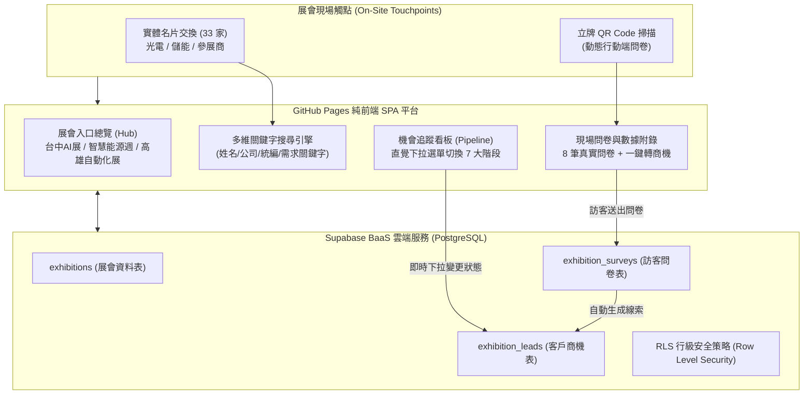

# 🏢 進金生能源 6692｜展覽客戶機會管理平台 (Exhibition Client Lead Management Platform)

> 專為 **進金生能源服務股份有限公司 (AcmePoint Energy Services 6692)** 打造的企業級展會客戶機會管理與多展會擴充戰情門戶。
> 結合 **現場名片快速檢索 ✕ 行動問卷 QR Code 直錄 ✕ 商機漏斗即時下拉確認 ✕ Supabase BaaS 雲端雙向同步 ✕ GitHub Pages 純前端託管**。

---

## 🌟 核心功能特色與亮點

### 1. 🏢 多展會擴充架構 (Multi-Exhibition Hub)
- **展會資料庫與入口切換**：預留完整擴充架構，以「2026 台中AI展」為首發展會，並預備「2026 台灣國際智慧能源週 (Energy Taiwan)」、「2026 高雄自動化工業展 (KIAE)」、「2027 COMPUTEX」等展會卡片。
- **一鍵切換與獨立管理**：所有客戶機會（Leads）、現場問卷（Surveys）皆具備 `exhibition_id` 欄位，支援獨立計算指標與獨立維護。
- **隨時新增展會**：內建「建立新展會」彈窗，業務主管可隨時建立新展期與主題。

### 2. 🔍 強大全域關鍵字搜尋與多維篩選
- **即時響應式搜尋**：支援跨欄位搜尋客戶姓名、公司名稱、部門職稱、手機、市話、統一編號、地址廠房、洽談備註關鍵字（如：新廠、穩壓、微逆、加line、ISO）。
- **多維度組合過濾**：
  - **業務擔當**：Vanessa、Jane、Lucy、Duck、待指派。
  - **來源分類**：光電 (7家)、儲能 (9家)、AI參展廠商 (10家)、現場問卷 (7家)。
  - **機會階段**：初次接觸、需求確認、場勘/技術評估、方案報價、商務談判、贏單簽約、暫緩/結案。
  - **意向等級**：🔥 高意向、⚡ 中意向、一般。
- **雙視圖無縫切換**：支援高質感卡片網格視圖（Cards View）與密集資料清單視圖（Table View）。

### 3. 🎯 客戶機會即時追蹤（下拉選單即時確認）
- **7 階段視覺化漏斗看板 (Pipeline Funnel)**：
  1. `初次接觸` (Slate)
  2. `需求確認` (Blue)
  3. `場勘/技術評估` (Purple)
  4. `方案報價` (Amber)
  5. `商務談判` (Orange)
  6. `贏單簽約` (Emerald - 觸發勝利禮炮特效)
  7. `暫緩/戰略結案` (Rose)
- **直覺下拉選單 (`<select>` Dropdown)**：每一筆客戶皆配備色彩鮮明的階段下拉選單，業務點選即刻生效、即時更新本地狀態、非同步寫入 Supabase 雲端資料庫，並跳出 Toast 狀態反饋！

### 4. 📋 附錄：現場訪客 QR Code 問卷調研系統
- **動態生成高解析度 QR Code**：接待人員可直接向現場訪客出示 QR Code 立牌，客戶以手機掃描即可開啟專屬問卷。
- **30 秒極速行動問卷**：針對企業光電屋頂、工商業表後儲能、削峰填谷、需量反應、家用儲能 AT 等需求量身打造。
- **自動關聯客戶機會名冊**：訪客手機提交問卷後，立即寫入雲端問卷庫，並自動在客戶名冊中建立潛在商機，省去展後人工鍵入時間。
- **收錄真實歷史問卷**：完整內建 2026 台中AI展 收集之 8 筆實名填答資料（信實物業、承達自動化、盛御縉、Mad Robotix、虎尾科大等）。

### 5. ⚡ GitHub Pages ✕ Supabase BaaS 無需設定開箱即用
- **符合 `github-supabase-web` 嚴格安全規範**：
  - 純前端架構（HTML5 + Tailwind CSS CDN + Vue 3 CDN + Supabase JS CDN），零 Node.js 構建依賴。
  - 僅暴露 Supabase `anon key`，絕無私鑰外洩風險。
  - 內建 `supabase-schema.sql` 具備 PostgreSQL RLS (Row Level Security) 行級安全策略。
- **零冷啟動等待**：預置 33 筆真實訪客名片與 8 筆問卷種子資料，即使在無網路或尚未建立雲端資料表時，業務成員點開即可直接檢索與操作！

---

## 🏗️ 系統架構圖 (Architecture)

---

## 🗄️ Supabase 資料庫快速建立指南

1. 登入 [Supabase Dashboard](https://supabase.com/dashboard/project/cowljafosekwvxithwjd/sql/new)
2. 複製專案根目錄的 [`supabase-schema.sql`](./supabase-schema.sql) 完整內容貼入 **SQL Editor** 並點擊 **Run**。
3. 腳本將自動建立：
   - `exhibitions` (展會基本資料表)
   - `exhibition_leads` (客戶名片與商機追蹤資料表)
   - `exhibition_surveys` (現場問卷資料表)
   - 自動開啟 RLS (Row Level Security) 並套用公開客戶端讀寫授權策略。
4. 打開網頁點選頂部右上角 **「Supabase 設定」**，點選 **「一鍵同步種子資料至雲端」**，即可將 33 筆訪客名片與 8 筆問卷完整推送至雲端！

---

## 👥 業務團隊分工配置 (STP Lead Routing)

| 業務人員 | 負責領域與展會商機分工 | 典型跟進客戶範例 |
| :--- | :--- | :--- |
| **Jane** | S1 Key Account 大客戶擴廠、精密製造、光電二期、既有合作廠商 | 和田精密、宣鑫企業、百埕地產、恆智重機、鎧澤科技、群崴國際 |
| **Vanessa** | 儲能專題開拓、台電穩壓改善、大型微逆系統、問卷進線商機 | 新穎機械、鎧威科技、倍得利、御鼎節能(鍋教授)、盛御縉、信實物業 |
| **Lucy** | 行銷與策略客戶、金融法金專案、大型園區新廠開發 | 金晶國際 (通霄3公頃新廠)、永豐商業銀行 (表後儲能放款) |
| **Duck** | 住宅型建案儲能、社區型微電網合作案 | 富華建設 (266戶住宅家用儲能規劃案) |

---

## 🚀 線上即開即用網址

- **GitHub Repository**: [https://github.com/davidyeh51/exhibition-lead-platform](https://github.com/davidyeh51/exhibition-lead-platform)
- **GitHub Pages 平台網址**: [https://davidyeh51.github.io/exhibition-lead-platform/](https://davidyeh51.github.io/exhibition-lead-platform/)

---

*進金生能源服務股份有限公司 (AcmePoint Energy Services 6692) 版權所有 © 2026*
